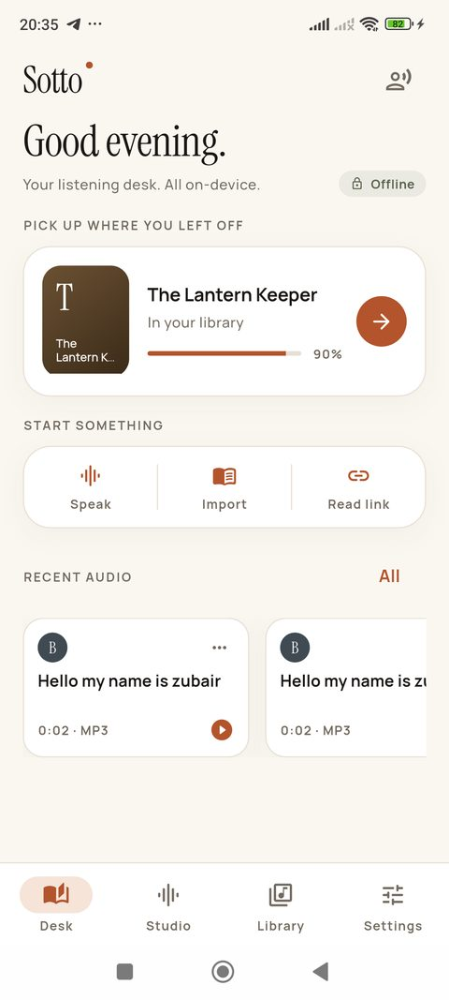
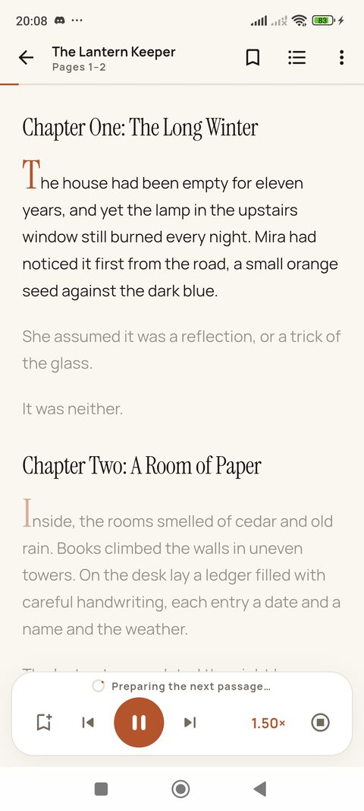
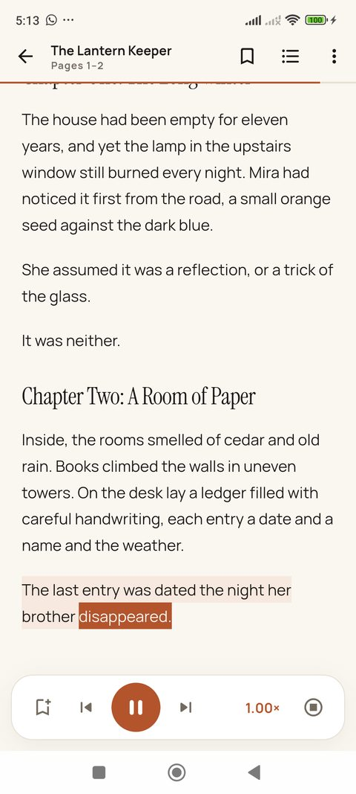
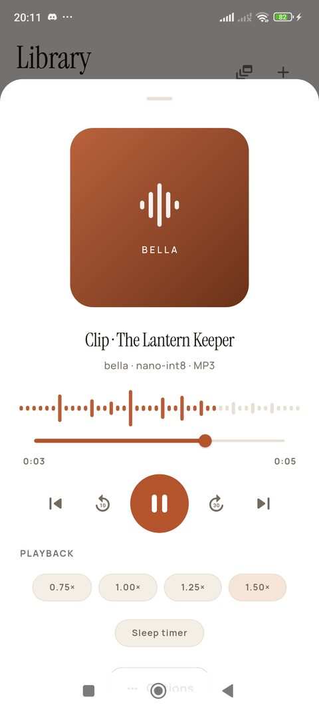
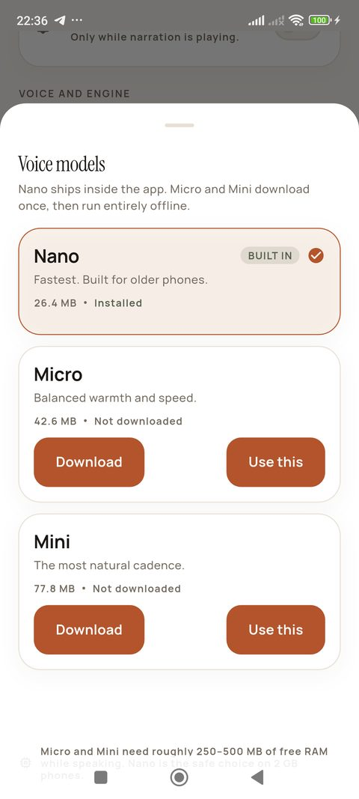
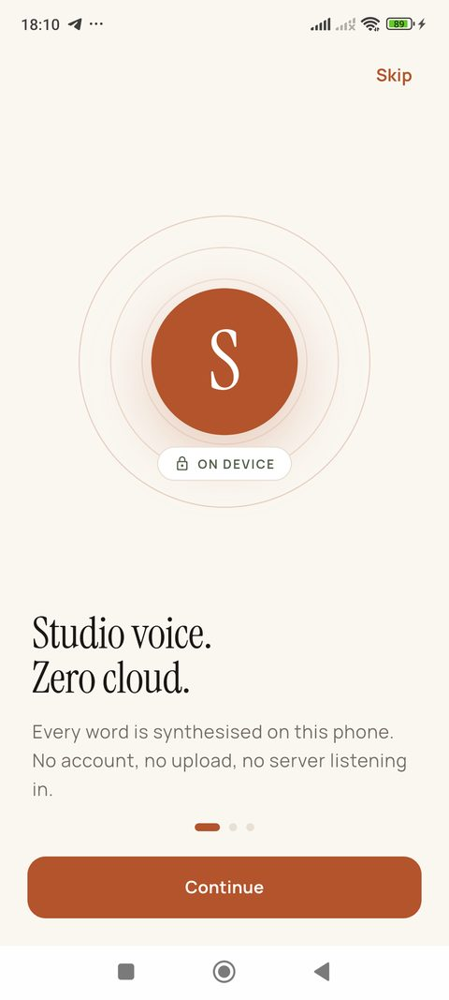

# Sotto

**Studio-grade narration, entirely offline.**

Sotto is a premium Android text-to-speech app built on Flutter and ONNX Runtime.
It runs KittenTTS neural voices locally — no account, no cloud, no text ever
leaves the phone.

## Screenshots

<p align="center">
  
  
  
</p>
<p align="center">
  
  
  
</p>

## What it does

- **Studio** — type or paste up to 6,000 characters, pick one of eight neural
  voices, set the pace, and render WAV or MP3.
- **Reader** — import PDF, EPUB, and TXT, or fetch an article link once. Sotto
  reads it aloud with sentence highlighting and word-level karaoke using the
  model's own timings, drop caps, and an optional focus mode that dims
  everything but the current passage.
- **Keeps reading across screens** — narration survives navigation, appears in
  the mini player, and keeps the media notification alive in the background.
- **Instant playback speed** — 0.75–1.75× applies immediately without
  re-synthesising; voice pace remains a separate synthesis setting.
- **Sleep timer** — 15/30/45/60 minutes with a gentle fade-out.
- **Subtitles and clips** — rendered audio gets an SRT sidecar, and any bookmark
  can be turned into a shareable audio clip.
- **Library** — every render is kept locally with duration, size, voice, and
  format, plus a real waveform from the audio. Rename, favourite, share,
  delete, and group into playlists. EPUB and PDF imports bring their covers.
- **Batch studio** — convert several documents in one queue, sentence by
  sentence, with per-document progress and cancellation.
- **Background playback** — a media notification and lock-screen controls keep
  exported audio playing with the screen off.
- **Model manager** — Nano INT8 ships inside the app; Micro and Mini download
  once with SHA-256 verification and then run offline forever.
- **Privacy ledger** — a plain-language inventory of every network path, plus an
  Offline Mode that blocks the ad SDK entirely.
- **Remove ads** — a US$4.99 one-time purchase through Google Play (product ID
  `sotto_remove_ads`), with restore support and a rewarded 24-hour Studio Pass
  as the free alternative.

## Voices

Eight English voices from KittenTTS v0.8: Bella, Jasper, Luna, Bruno, Rosie,
Hugo, Kiki, Leo. Output is 24 kHz mono. English is the only language shipped
because it is the only one validated for these weights.

## Architecture

```
lib/
  app/            Material 3 theme, shell, shared widgets
  ads/            AdMob + UMP consent, Offline Mode kill switch
  audio/          audio_service handler, just_audio bridge
  core/           WAV/MP3 writers, document renderer, export helpers
  data/           sqflite schema and models
  features/
    desk/         home
    studio/       synthesis, voice picker, model manager
    reader/       reader content model, narration controller, UI
    library/      documents, audio, playlists
    batch/        batch conversion
    import/       PDF/EPUB/TXT/article parsing and import flows
    settings/     preferences, privacy ledger, notices
  state/          settings, library, and player controllers
  tts/            model catalog/repository, engine service, phonemizer
packages/kittentts/   vendored Apache-2.0 SDK (analytics removed)
android/app/src/main/cpp/   LAME 3.100 build for MP3 export
assets/models/       bundled Nano INT8 model + voice bank
```

**Pipeline:** text → number expansion → MIT `phonemize` G2P (CMU-derived
English dictionary, stress marks normalised to espeak conventions) → KittenTTS
phoneme tokens → ONNX Runtime → Float32 PCM → streaming WAV or LAME MP3.

**Memory strategy:** the ONNX session is unloaded after two idle minutes,
synthesis happens per sentence, narration renders 3–4 sentences ahead, and file
writers stream to disk so a full book never sits in RAM.

## Build

Requirements: Flutter 3.44+, JDK 21, Android SDK 36, NDK 28.2.13676358,
CMake 3.22.1 (all available through the Android SDK manager).

```bash
flutter pub get
flutter test
flutter build apk --debug                       # sideload build
flutter build appbundle --release               # Play Store bundle
flutter build apk --release --split-per-abi     # smaller APKs
```

Release signing reads `android/key.properties`:

```properties
storePassword=...
keyPassword=...
keyAlias=sotto
storeFile=../keystore/sotto.jks
```

If the file is absent the release build falls back to debug signing — never
publish that artefact.

## Before publishing

1. Replace the three AdMob **test** unit IDs in `lib/ads/ad_service.dart` and the
   `com.google.android.gms.ads.APPLICATION_ID` value in
   `android/app/src/main/AndroidManifest.xml`.
2. Host `PRIVACY.md` at a public HTTPS URL, fill in the support email, and add
   the URL to the Play Console listing and the Data Safety form.
3. Create a real upload keystore and keep it out of version control.
4. Re-check the Data Safety form: no account data, no analytics; ads collect
   device/ad identifiers when enabled.
5. Build the AAB and verify 16 KB native alignment (NDK r28 does this by
   default).

## Known limitations

- English only.
- PDF reading requires selectable text; scanned pages need OCR, which is not
  included.
- Live narration stops when you leave the reader. Exported audio plays in the
  background through the media service.
- Word highlighting depends on the model's timing output and is approximate for
  unusual punctuation.
- Verified on a Redmi Note 11 (Android 13, arm64, 5.7 GB RAM). Other Android
  versions and OEM skins are untested. Synthesis runs at roughly real-time on
  this Snapdragon 680 (RTF 1.05x).

## Release artifacts

`dist/` contains signed per-ABI APKs (no bundle by request):

- `sotto-1.0.0-arm64-v8a.apk` — most phones.
- `sotto-1.0.0-armeabi-v7a.apk` — older 32-bit phones.
- `sotto-1.0.0-x86_64.apk` — emulators.
- `SHA256SUMS.txt`

If a Play Store release is needed later, generate the bundle with
`flutter build appbundle --release`. `RELEASE_CHECKLIST.md` lists what must
change first (ad IDs, privacy URL, support email, Play Console forms).

## Verification

Debug and release builds were exercised on a Redmi Note 11 (Android 13, arm64):
on-device synthesis (RTF ~1.05x), WAV/MP3 export parsed frame-by-frame, TXT/EPUB/
PDF import, sentence and word highlighting, batch conversion, background media
notification, model download with SHA-256, Offline Mode, onboarding, narration
that survives navigation, instant playback speed, drop caps, focus mode, and real
book covers. The release-only R8 WorkManager crash found in that pass was fixed
and re-tested. The v1.1 polish was re-verified on the final build: PDF cover
overlay, softer focus dim, clip export (including during narration), SRT
subtitles, sleep timer, real waveform, and instant playback speed.
Details: `QA_REPORT.md`.

## Licensing

See `THIRD_PARTY_NOTICES.md` and `AUDIT.md`. KittenTTS weights are Apache-2.0.
LAME is LGPL-2.1, dynamically linked, with source included.
